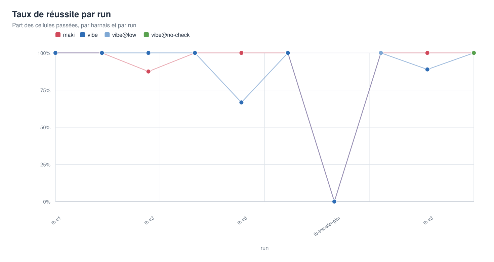
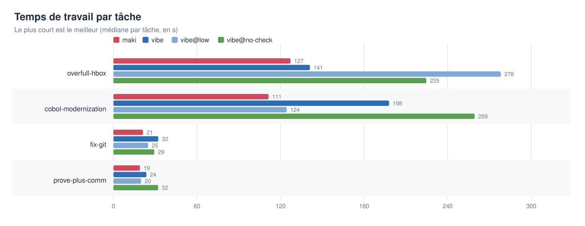
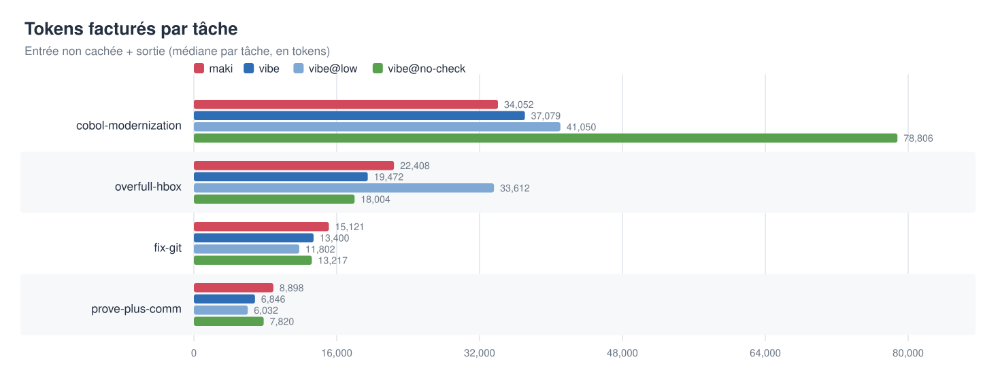
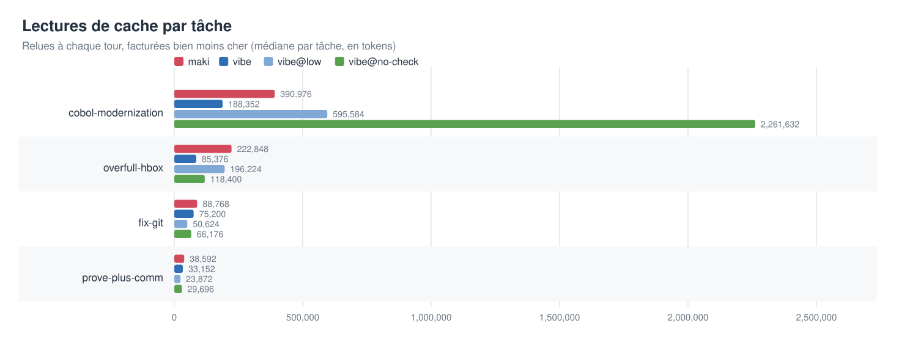
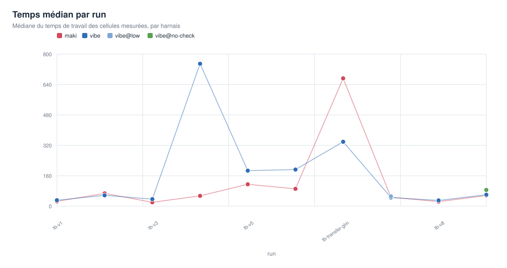
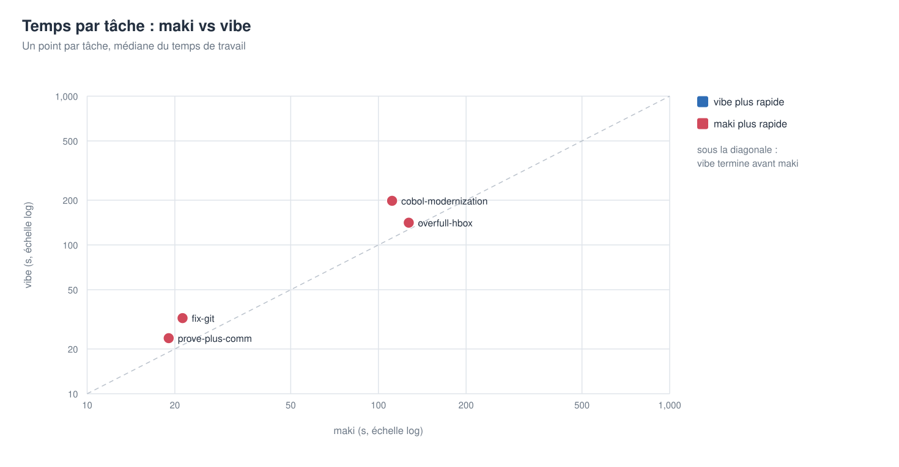

# Terminal-Bench tasks: maki vs this fork

Real Terminal-Bench tasks: the agent works on a copy of the built task
image, then the task's own tests run in that image. Same model
(`mistral/deepseek-v4-1-flash-1017`). Every row carries the four metrics
together: resolve, prompt tokens, tool calls, wall-clock work time
(harness startup excluded).

| run | commit | task | harness | resolve | median tok | median cache-read | median fresh | median calls | median tool s | median s | verdict |
|---|---|---|---|---|---|---|---|---|---|---|---|
| tb-v1 | `0714c59` | fix-git | maki | 3/3 | 181314 | 166400 | 14914 | 0 | n/a | 31.7 | - |
| tb-v1 | `0714c59` | fix-git | vibe | 3/3 | 123580 | 109696 | 13729 | 0 | n/a | 39.7 | maki |
| tb-v1 | `0714c59` | prove-plus-comm | maki | 3/3 | 98422 | 90496 | 7926 | 0 | n/a | 20.9 | - |
| tb-v1 | `0714c59` | prove-plus-comm | vibe | 3/3 | 58013 | 52992 | 5021 | 0 | n/a | 25.1 | maki |
| tb-v2 | `012ea89` | cobol-modernization | maki | 2/2 | 1759124 | 1725440 | 33684 | 0.0 | n/a | 200.0 | - |
| tb-v2 | `012ea89` | cobol-modernization | vibe | 2/2 | 1479082 | 1441536 | 37546 | 0.0 | n/a | 158.8 | vibe |
| tb-v2 | `012ea89` | fix-git | maki | 2/2 | 433814 | 390144 | 43670 | 0.0 | n/a | 49.8 | - |
| tb-v2 | `012ea89` | fix-git | vibe | 2/2 | 167618 | 154176 | 13442 | 0.0 | n/a | 51.5 | maki |
| tb-v2 | `012ea89` | overfull-hbox | maki | 2/2 | 279027 | 260672 | 18355 | 0.0 | n/a | 104.8 | - |
| tb-v2 | `012ea89` | overfull-hbox | vibe | 2/2 | 137108 | 125824 | 11284 | 0.0 | n/a | 108.3 | maki |
| tb-v2 | `012ea89` | prove-plus-comm | maki | 2/2 | 80166 | 72128 | 8038 | 0.0 | n/a | 18.4 | - |
| tb-v2 | `012ea89` | prove-plus-comm | vibe | 2/2 | 57940 | 52160 | 5780 | 0.0 | n/a | 30.2 | maki |
| tb-v3 | `012ea89` | cobol-modernization | maki | 2/2 | 1303028 | 1274176 | 28852 | 0.0 | n/a | 119.5 | - |
| tb-v3 | `012ea89` | cobol-modernization | vibe | 2/2 | 975494 | 950848 | 24646 | 0.0 | n/a | 162.9 | maki |
| tb-v3 | `012ea89` | fix-git | maki | 2/2 | 93574 | 82112 | 11462 | 0.0 | n/a | 16.0 | - |
| tb-v3 | `012ea89` | fix-git | vibe | 2/2 | 89277 | 78208 | 11069 | 0.0 | n/a | 27.1 | maki |
| tb-v3 | `012ea89` | overfull-hbox | maki | 1/2 | 110448 | 98688 | 11760 | 0.0 | n/a | 31.7 | - |
| tb-v3 | `012ea89` | overfull-hbox | vibe | 2/2 | 110784 | 98880 | 11904 | 0.0 | n/a | 87.7 | vibe (resolve) |
| tb-v3 | `012ea89` | prove-plus-comm | maki | 2/2 | 81875 | 74688 | 7187 | 0.0 | n/a | 14.5 | - |
| tb-v3 | `012ea89` | prove-plus-comm | vibe | 2/2 | 12994 | 9856 | 3138 | 0.0 | n/a | 11.1 | vibe |
| tb-v4 | `48c18a4` | cobol-modernization | maki | 3/3 | 279972 | 263040 | 16932 | 0 | n/a | 54.2 | - |
| tb-v4 | `48c18a4` | cobol-modernization | vibe | 3/3 | 137693 | 105984 | 31709 | 0 | n/a | 749.2 | maki |
| tb-v5 | `69f9ae0` | cobol-modernization | maki | 3/3 | 434485 | 420736 | 18123 | 0 | n/a | 115.0 | - |
| tb-v5 | `69f9ae0` | cobol-modernization | vibe | 2/3 | 237978 | 207360 | 30618 | 0 | n/a | 187.0 | maki (resolve) |
| tb-v6 | `eb7e3dd` | cobol-modernization | maki | 3/3 | 553096 | 535552 | 17544 | 29 | n/a | 91.0 | - |
| tb-v6 | `eb7e3dd` | cobol-modernization | vibe | 3/3 | 152566 | 125952 | 26614 | 11 | n/a | 192.6 | maki |
| tb-transfer-glm | `153f621` | cobol-modernization | maki | 0/1 | 1860956 | 1527552 | 333404 | 47 | n/a | 672.6 | - |
| tb-transfer-glm | `153f621` | cobol-modernization | vibe | 0/1 | 0 | 0 | 0 | 0 | n/a | 338.8 | vibe |
| tb-v7 | `3399387` | cobol-modernization | maki | 2/2 | 1574366 | 1536960 | 37406 | 35.5 | n/a | 238.9 | - |
| tb-v7 | `3399387` | cobol-modernization | vibe@low | 2/2 | 616172 | 595584 | 20588 | 25.0 | 9.3 | 124.4 | vibe |
| tb-v7 | `3399387` | cobol-modernization | vibe | 2/2 | 238302 | 222720 | 15582 | 16.0 | 5.4 | 79.3 | vibe |
| tb-v7 | `3399387` | fix-git | maki | 2/2 | 93784 | 81856 | 11928 | 12.0 | n/a | 16.9 | - |
| tb-v7 | `3399387` | fix-git | vibe@low | 2/2 | 60003 | 50624 | 9379 | 10.5 | 1.1 | 24.9 | maki |
| tb-v7 | `3399387` | fix-git | vibe | 2/2 | 65236 | 56064 | 9172 | 10.5 | 0.9 | 29.5 | maki |
| tb-v7 | `3399387` | overfull-hbox | maki | 2/2 | 321052 | 299584 | 21468 | 17.0 | n/a | 207.9 | - |
| tb-v7 | `3399387` | overfull-hbox | vibe@low | 2/2 | 218160 | 196224 | 21936 | 15.0 | 211.1 | 278.1 | maki |
| tb-v7 | `3399387` | overfull-hbox | vibe | 2/2 | 114474 | 99072 | 15402 | 12.0 | 276.0 | 314.2 | maki |
| tb-v7 | `3399387` | prove-plus-comm | maki | 2/2 | 33776 | 26880 | 6896 | 5.0 | n/a | 10.6 | - |
| tb-v7 | `3399387` | prove-plus-comm | vibe@low | 2/2 | 28199 | 23872 | 4327 | 6.5 | 1.3 | 19.9 | maki |
| tb-v7 | `3399387` | prove-plus-comm | vibe | 2/2 | 41108 | 36224 | 4884 | 8.0 | 1.6 | 24.4 | maki |
| tb-v8 | `a6e9337` | fix-git | maki | 3/3 | 80924 | 71168 | 10209 | 11 | n/a | 15.7 | - |
| tb-v8 | `a6e9337` | fix-git | vibe | 3/3 | 76761 | 67200 | 9561 | 13 | 1.4 | 30.1 | maki |
| tb-v8 | `a6e9337` | overfull-hbox | maki | 3/3 | 188410 | 173824 | 13661 | 13 | n/a | 127.2 | - |
| tb-v8 | `a6e9337` | overfull-hbox | vibe | 2/3 | 90556 | 71040 | 12351 | 9 | 53.3 | 119.5 | maki (resolve) |
| tb-v8 | `a6e9337` | prove-plus-comm | maki | 3/3 | 49751 | 42496 | 7255 | 6 | n/a | 23.7 | - |
| tb-v8 | `a6e9337` | prove-plus-comm | vibe | 3/3 | 18507 | 14848 | 3659 | 4 | 0.6 | 18.9 | vibe |
| tb-v9 | `e08d961` | cobol-modernization | maki | 2/2 | 250840 | 235392 | 15448 | 16.5 | n/a | 65.4 | - |
| tb-v9 | `e08d961` | cobol-modernization | vibe@no-check | 2/2 | 2303242 | 2261632 | 41610 | 42.0 | 17.7 | 259.3 | maki |
| tb-v9 | `e08d961` | cobol-modernization | vibe | 2/2 | 726582 | 696576 | 30006 | 20.5 | 5.4 | 140.3 | maki |
| tb-v9 | `e08d961` | fix-git | maki | 2/2 | 121828 | 110080 | 11748 | 14.5 | n/a | 28.5 | - |
| tb-v9 | `e08d961` | fix-git | vibe@no-check | 2/2 | 76450 | 66176 | 10274 | 12.0 | 1.5 | 29.4 | maki |
| tb-v9 | `e08d961` | fix-git | vibe | 2/2 | 59131 | 50624 | 8507 | 11.5 | 1.3 | 29.8 | maki |
| tb-v9 | `e08d961` | overfull-hbox | maki | 2/2 | 271748 | 248640 | 23108 | 15.5 | n/a | 135.3 | - |
| tb-v9 | `e08d961` | overfull-hbox | vibe@no-check | 2/2 | 129690 | 118400 | 11290 | 10.5 | 177.0 | 224.6 | maki |
| tb-v9 | `e08d961` | overfull-hbox | vibe | 2/2 | 171077 | 149824 | 21253 | 11.5 | 92.4 | 200.6 | maki |
| tb-v9 | `e08d961` | prove-plus-comm | maki | 2/2 | 64946 | 57920 | 7026 | 8.0 | n/a | 32.6 | - |
| tb-v9 | `e08d961` | prove-plus-comm | vibe@no-check | 2/2 | 34486 | 29696 | 4790 | 7.5 | 1.4 | 32.1 | vibe |
| tb-v9 | `e08d961` | prove-plus-comm | vibe | 2/2 | 68027 | 62784 | 5243 | 12.0 | 2.0 | 36.5 | maki |

## Cost per resolved task

What a solved task really costs: all three budgets divided by the tasks
that actually resolved, so a run that fails cheaply does not look good.

| run | harness | resolve | tokens / resolved | cache-read / resolved | fresh / resolved | calls / resolved | tool min / resolved | minutes / resolved | tool share | p95 s |
|---|---|---|---|---|---|---|---|---|---|---|
| tb-v1 | maki | 100% | 214668 | 201216 | 13452 | 0.0 | None | 0.85 | None | 193.5 |
| tb-v1 | vibe | 100% | 91400 | 82517 | 8883 | 0.0 | None | 0.52 | None | 44.9 |
| tb-v2 | maki | 100% | 638033 | 612096 | 25937 | 0.0 | None | 1.55 | None | 229.9 |
| tb-v2 | vibe | 100% | 460437 | 443424 | 17013 | 0.0 | None | 1.45 | None | 255.9 |
| tb-v3 | maki | 88% | 453978 | 437047 | 16932 | 0.0 | None | 0.87 | None | 180.9 |
| tb-v3 | vibe | 100% | 297137 | 284448 | 12689 | 0.0 | None | 1.2 | None | 282.2 |
| tb-v4 | maki | 100% | 272466 | 256981 | 15484 | 0.0 | None | 1.19 | None | 110.7 |
| tb-v4 | vibe | 100% | 292868 | 261973 | 30894 | 0.0 | None | 11.07 | None | 901.6 |
| tb-v5 | maki | 100% | 786993 | 768213 | 18780 | 0.0 | None | 2.6 | None | 240.7 |
| tb-v5 | vibe | 67% | 253367 | 221696 | 31671 | 0.0 | None | 10.49 | None | 901.7 |
| tb-v6 | maki | 100% | 1455374 | 1434411 | 20963 | 37.7 | None | 2.71 | None | 367.5 |
| tb-v6 | vibe | 100% | 188140 | 156672 | 31468 | 11.0 | None | 3.79 | None | 356.6 |
| tb-transfer-glm | maki | 0% | 1860956 | 1527552 | 333404 | 47.0 | None | 11.21 | None | 672.6 |
| tb-transfer-glm | vibe | 0% | 0 | 0 | 0 | 0.0 | None | 5.65 | None | 338.8 |
| tb-v7 | maki | 100% | 505744 | 486320 | 19424 | 17.4 | None | 1.98 | None | 403.1 |
| tb-v7 | vibe | 100% | 114780 | 103520 | 11260 | 11.6 | 1.18 | 1.86 | 0.634 | 400.5 |
| tb-v7 | vibe@low | 100% | 230633 | 216576 | 14057 | 14.2 | 0.93 | 1.86 | 0.498 | 430.7 |
| tb-v8 | maki | 100% | 108793 | 98446 | 10347 | 10.8 | None | 1.13 | None | 250.6 |
| tb-v8 | vibe | 89% | 80146 | 69936 | 10210 | 10.4 | 0.88 | 1.46 | 0.599 | 372.8 |
| tb-v9 | maki | 100% | 177340 | 163008 | 14332 | 13.6 | None | 1.09 | None | 146.0 |
| tb-v9 | vibe | 100% | 256204 | 239952 | 16252 | 13.9 | 0.42 | 1.7 | 0.248 | 243.9 |
| tb-v9 | vibe@no-check | 100% | 635967 | 618976 | 16991 | 18.0 | 0.82 | 2.27 | 0.362 | 382.7 |

## Graphs

One chart per question over every recorded run: pass rate, work time,
billed tokens and cache reads per task, median time per run, and both
harnesses against each other. Tokens are normalised first, since the
two CLIs count cache reads differently. `record_tb.py` redraws the
charts here, and `python3 benchmarks/plot_tb.py` reproduces them alone.

