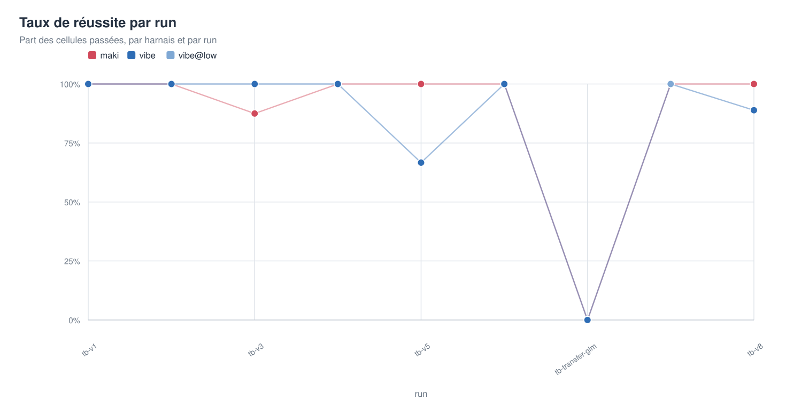
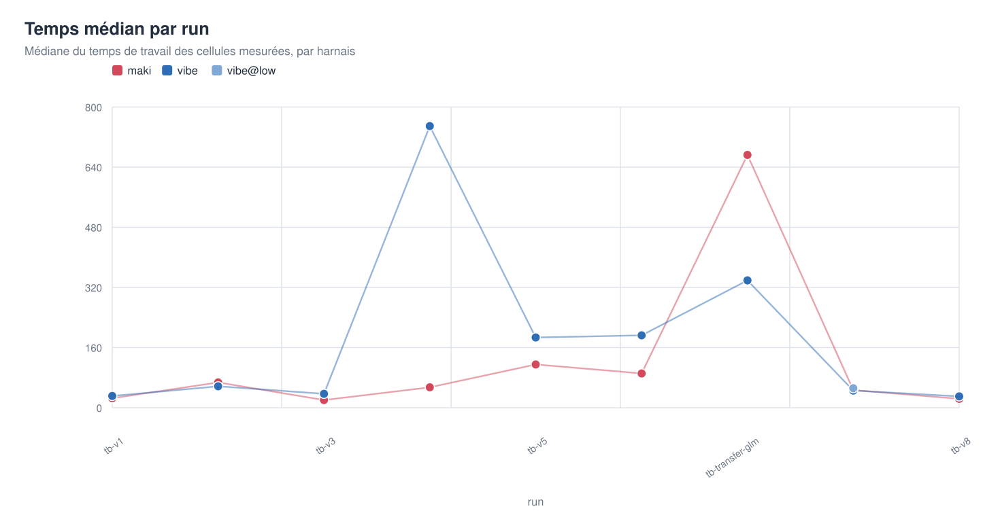
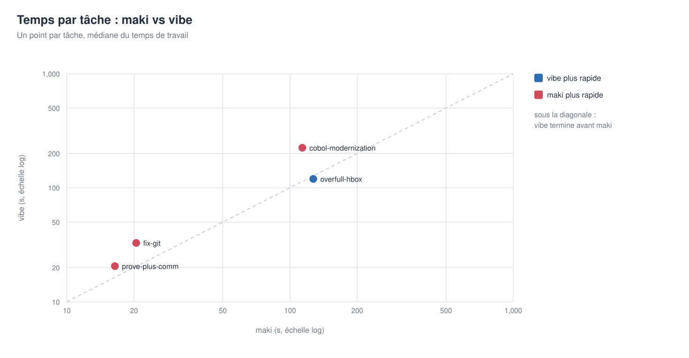

# Terminal-Bench : graphiques

9 runs, du tb-v1 au tb-v8.

Médianes par harnais ; les temps excluent les cellules non mesurées.

| harnais | cellules | réussite | temps médian | tokens non cachés | coût médian | tours médians |
|---|---|---|---|---|---|---|
| maki | 49 | 96% (47/49) | 45 s | 19,314 | $0.011 | 14 |
| vibe | 49 | 94% (46/49) | 52 s | 91,603 | non rapporté | 10 |
| vibe@low | 8 | 100% (8/8) | 52 s | 130,695 | non rapporté | 12 |

## Taux de réussite par run

## Temps de travail par tâche

## Tokens non cachés par tâche

## Temps médian par run

## maki vs vibe par tâche

