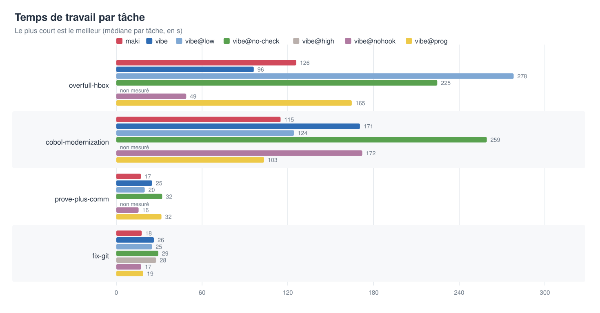
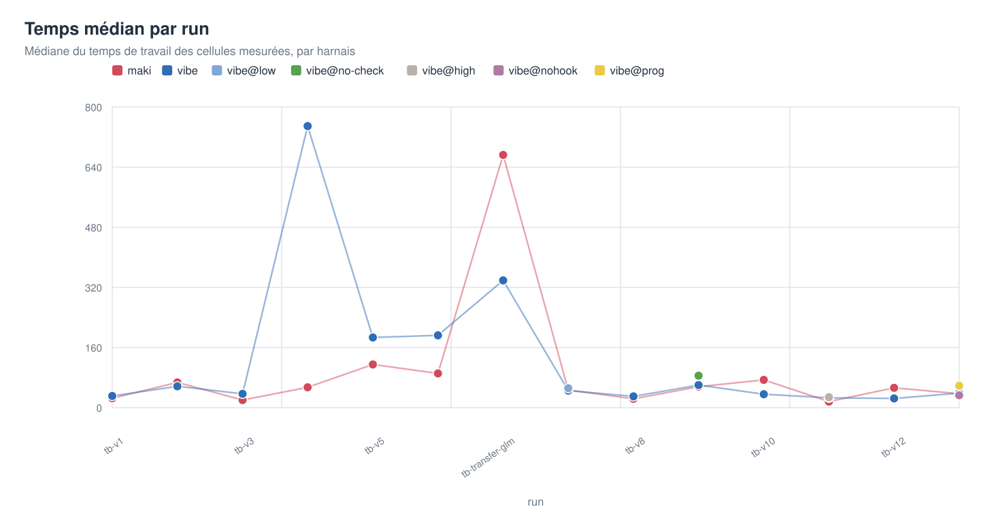

# Terminal-Bench : graphiques

14 runs, du tb-v1 au tb-v13.

Médianes par harnais ; les temps excluent les cellules non mesurées.

| harnais | cellules | réussite | temps médian | tokens facturés | lectures cache | coût médian | tours médians |
|---|---|---|---|---|---|---|---|
| maki | 88 | 98% (86/88) | 43 s | 17,554 | 117,312 | $0.011 | 12 |
| vibe | 88 | 97% (85/88) | 42 s | 13,878 | 67,392 | non rapporté | 10 |
| vibe@low | 8 | 100% (8/8) | 52 s | 18,804 | 111,168 | non rapporté | 12 |
| vibe@no-check | 8 | 100% (8/8) | 85 s | 15,284 | 66,176 | non rapporté | 10 |
| vibe@high | 3 | 100% (3/3) | 28 s | 12,371 | 64,000 | non rapporté | 11 |
| vibe@nohook | 8 | 100% (8/8) | 33 s | 10,367 | 40,704 | non rapporté | 8 |
| vibe@prog | 8 | 100% (8/8) | 58 s | 15,514 | 95,680 | non rapporté | 10 |

## Taux de réussite par run

## Temps de travail par tâche

## Tokens facturés par tâche

## Lectures de cache par tâche

## Temps médian par run

## maki vs vibe par tâche

