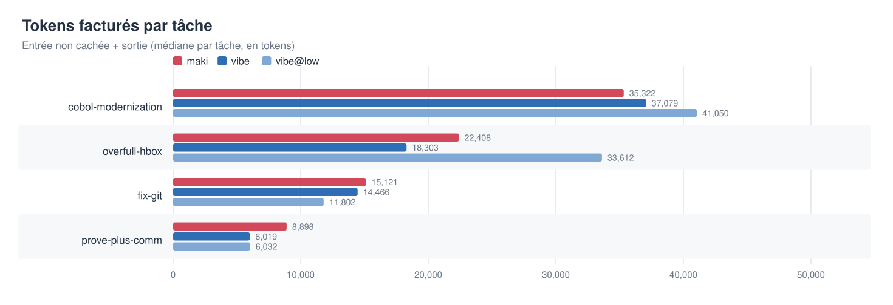
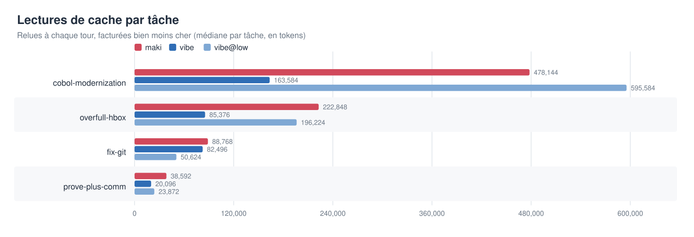

# Terminal-Bench : graphiques

9 runs, du tb-v1 au tb-v8.

Médianes par harnais ; les temps excluent les cellules non mesurées.

| harnais | cellules | réussite | temps médian | tokens facturés | lectures cache | coût médian | tours médians |
|---|---|---|---|---|---|---|---|
| maki | 49 | 96% (47/49) | 45 s | 19,314 | 146,688 | $0.011 | 14 |
| vibe | 49 | 94% (46/49) | 52 s | 15,432 | 71,040 | non rapporté | 10 |
| vibe@low | 8 | 100% (8/8) | 52 s | 18,804 | 111,168 | non rapporté | 12 |

## Taux de réussite par run

## Temps de travail par tâche

## Tokens facturés par tâche

## Lectures de cache par tâche

## Temps médian par run

## maki vs vibe par tâche

